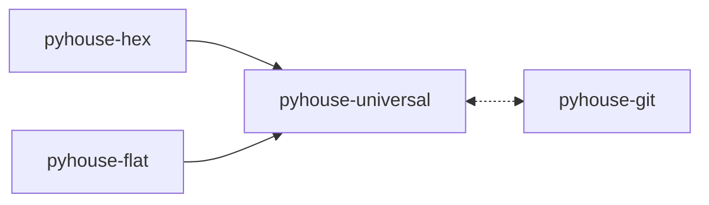

# pyhouse

House-style rules for writing Python services, as Claude Code skills.

Forty-nine skills covering naming, packaging, settings, the toolchain, versioning, errors and tests — plus two mutually exclusive service
architectures. They are project-neutral: worked examples use `myapp` and `Foo`, never a real service
name.

- [Install](#install)
- [Setting up a repository](#setting-up-a-repository)
- [Which family?](#which-family)
- [Reviewing existing code](#reviewing-existing-code)
- [How a skill is written](#how-a-skill-is-written)
- [The catalogue](#the-catalogue)
- [Licence](#licence)

## Install

Install all four plugins:

```bash
claude plugin marketplace add wntic/pyhouse
claude plugin install pyhouse-universal@pyhouse
claude plugin install pyhouse-hex@pyhouse
claude plugin install pyhouse-flat@pyhouse
claude plugin install pyhouse-git@pyhouse
```

Each plugin installs and works on its own, but the catalogue is written as one piece and the plugins
lean on each other beyond what their manifests declare:



A solid arrow is a declared dependency, which Claude Code installs for you. The dashed one is a
reference that degrades quietly when its target is missing — and so are the references between the
plugins the picture leaves out: `/choose-architecture` recommends a
family whose skills are not there, a skill points at the other family's equivalent and the name
dangles, `/pyhouse-universal:code-review` skips commit messages, `/release` computes versions without
the rules that say what a version promises. Installing everything removes those gaps; installing a
subset is supported, but you get less than the catalogue describes.

- **Only one family.** Fine once the family is settled and will stay so; leaving the other one out
  saves skill-listing budget (see [Setting up a repository](#setting-up-a-repository)).
- **`pyhouse-universal` alone.** The language-level rules, for a library or a CLI tool, which neither
  family covers.
- **`pyhouse-git` alone.** For a repository in any other language: it depends on nothing.

| Plugin | Skills | What it covers |
|---|---|---|
| `pyhouse-universal` | 18 | Naming, typing and logging, packaging and re-exports, settings from the environment, the data-access obligations every store meets, what a program owes a message or a webhook delivered at least once and what a relay of a recorded effect owes, the lint, type-check and dependency configuration every distribution carries once, what a version promises and what changes it, the error catalogue, the testing constitution, the workspace root when one repository holds several distributions, the container image a runnable program ships in, a command-line interface's commands, exit codes and test, the architecture chooser, `/pyhouse-universal:adopt`, which tells a repository's agents which skill governs each kind of Python work, and the reviewer that applies all of it to code that already exists. |
| `pyhouse-hex` | 23 | Ports and adapters: layer boundaries, the composition root, entities and value objects, CQRS handlers, persistence with paired migrations, the REST family, eight test families. |
| `pyhouse-git` | 2 | `git-commit-message`, the Conventional Commits convention an agent follows whenever it writes a commit message. `git-branching`, how a change reaches the mainline: one merge method per repository, short-lived branches, history cleaned before it lands and never rewritten after. A language-independent `/commit`: stages the named files and reviews the staged diff, then writes a Conventional Commits message whose type carries the release the change earns. `/pyhouse-git:adopt` records in the repository's agent instructions how its changes branch, land and are committed, and turns off the agent's own authorship line. `/install-commit-hook` adds a `commit-msg` hook that refuses a malformed message at commit time. `/release` proposes the next version from the commit types since the last tag, per plugin or package, and cuts it only on an explicit yes. `/release-notes` then drafts the release note for the people using the project — what changed for them, what a break asks of them — from the changes themselves rather than the commit subjects. Depends on nothing; install it on its own. |
| `pyhouse-flat` | 8 | Package-by-technical-role for workers, pipelines and ETL: the package layout and its import contract, the one-time project setup, one package per store owning a service's data access, trigger choice from loop to durable execution, four test families. |

## Setting up a repository

Installing the plugins makes the skills available; it does not make an agent use them. Do this once
per repository, new or existing, from a Claude Code session at its root:

1. **Have a `CLAUDE.md`.** In an existing repository run `/init` first if there is none, so the adopt
   commands add to a file that already describes the project; otherwise they create a bare one.
2. **Settle the family, if it is not.** For a new service, `/choose-architecture`. Skip it for a
   library or a CLI tool, which belong to neither family.
3. **`/pyhouse-universal:adopt [hex | flat]`** writes a `## Python house style` section into
   `CLAUDE.md`: which skill to load before each kind of Python work. Pass the family only once the code
   already follows it — the command never picks one, and without the argument it leaves the family's
   layout row out.
4. **`/pyhouse-git:adopt`** writes a `## Branches and commits` section — the mainline, the merge method
   and the branch-name pattern, confirmed with you before it is written — and sets
   `"attribution": {"commit": "", "pr": ""}` in `.claude/settings.json`, so Claude Code stops adding
   its own authorship line.
5. **`/pyhouse-git:install-commit-hook shared`** puts a `commit-msg` hook in `.githooks/` and points
   `core.hooksPath` at it, so a malformed message is refused whoever writes it. `core.hooksPath` is
   per-clone: every contributor runs `git config core.hooksPath .githooks` once, so put it in the
   repository's setup script if it has one. Use `local` instead to try the hook in your clone only.
6. **Raise the skill-listing budget.** The catalogue takes most of Claude Code's skill-listing budget,
   so with the default some skills are listed by name alone, without the description that makes them
   fire. Add `"skillListingBudgetFraction": 0.02` to `.claude/settings.json` (the default is `0.01`;
   `0.02` lists the whole catalogue). No command writes it.
7. **Commit the result** — `CLAUDE.md`, `.claude/settings.json` and `.githooks/` — as one change of its
   own, by the branching you just recorded. Check that `.claude/` is not ignored by git: otherwise the
   settings reach no one else.

Running either adopt command again updates the section it wrote rather than adding a second one.

## Which family?

> **Does this service have business invariants of its own that it must enforce?**

Rules about what is valid living in your codebase — **hexagonal**. Orchestrating external systems,
where correctness is whether the data moved — **flat-layered**. A script run once and deleted, or a
project whose layout Django, Airflow or a package-by-feature convention already fixes — neither.

Run `/choose-architecture` for the cases that are not clean: invariants *and* heavy integration work,
a flat service growing its first rule, a monorepo holding both, and the shapes the catalogue does not
cover.

## Reviewing existing code

The same rules are the review criteria. `/pyhouse-universal:code-review` reads a diff, a commit range or a path and
reports where the code departs from them; it runs in a subagent, so reading the tree and the skills
costs the calling session nothing but the report.

It states no rules of its own. It works out which family the code is in — or that it is in neither,
which is the answer for a Django tree, a library, a CLI or an ML project, and means most of the
catalogue does not bind — then checks each skill's own precondition before holding the code to its
rules. Every finding names the skill and the rule or hard stop it came from; anything it cannot
attribute is reported as a gap in the catalogue, not as a finding against you.

It reports obligations, never a difference from a template: a finding you would have to change
library to act on is a review of that library, which its own tooling does better.

## How a skill is written

`## Rules` states what must be true in terms that survive changing library. `## Template(s)` carries
one concrete binding, named in its heading. `## Other bindings` names the alternatives. `## Hard stops`
are stops, not advice.

So the rules still hold if you swap the ORM, the DI container or the logger.

## The catalogue

[`plugins/pyhouse-universal/skills/README.md`](plugins/pyhouse-universal/skills/README.md) lists every
skill and what it owns. `meta-skill-author` is the format's own authority.

## Licence

MIT — see [`LICENSE`](LICENSE).

Copying the templates into your own project needs no attribution and puts no obligation on the code
around them. The attribution clause covers redistributing the catalogue itself.
