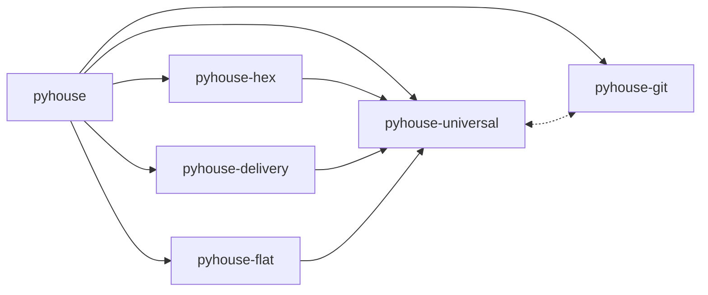

# pyhouse

House-style rules for writing Python services, as Claude Code skills.

Forty-nine skills covering naming, packaging, settings, the toolchain, versioning, errors and tests — plus two mutually exclusive service
architectures. They are project-neutral: worked examples use `myapp` and `Foo`, never a real service
name.

- [Install](#install)
- [Setting up a repository](#setting-up-a-repository)
- [Which family?](#which-family)
- [Reviewing existing code](#reviewing-existing-code)
- [Writing the spec for a change](#writing-the-spec-for-a-change)
- [Implementing a spec](#implementing-a-spec)
- [How a skill is written](#how-a-skill-is-written)
- [The catalogue](#the-catalogue)
- [Licence](#licence)

## Install

```bash
claude plugin marketplace add wntic/pyhouse
claude plugin install pyhouse@pyhouse
```

`pyhouse` holds no skills of its own. It depends on the other five plugins, so Claude Code installs
all of them with it, and it ships `/pyhouse:setup`, which sets a repository up for them in one run.

Each plugin installs and works on its own, but the catalogue is written as one piece and the plugins
lean on each other beyond what their manifests declare:



A solid arrow is a declared dependency, which Claude Code installs for you. The dashed one is a
reference that degrades quietly when its target is missing — and so are the references between the
plugins the picture leaves out: `/choose-architecture` recommends a family whose skills are not there,
a skill points at the other family's equivalent and the name dangles,
`/pyhouse-universal:code-review` skips commit messages, `/release` computes versions without the rules
that say what a version promises. Installing everything removes those gaps; installing a subset is
supported, but you get less than the catalogue describes, and you run the setup commands yourself.

- **Only one family.** `claude plugin install pyhouse-hex@pyhouse` (or `pyhouse-flat`), which brings
  `pyhouse-universal`, plus `pyhouse-git`. Fine once the family is settled and will stay so.
- **`pyhouse-universal` alone.** The language-level rules, for a library or a CLI tool, which neither
  family covers.
- **`pyhouse-git` alone.** For a repository in any other language: it depends on nothing.

| Plugin | Skills | What it covers |
|---|---|---|
| `pyhouse` | 0 | The whole catalogue in one install, and `/pyhouse:setup`, which runs the other plugins' setup commands in order. States no rule of its own. |
| `pyhouse-universal` | 18 | Naming, typing and logging, packaging and re-exports, settings from the environment, the data-access obligations every store meets, what a program owes a message or a webhook delivered at least once and what a relay of a recorded effect owes, the lint, type-check and dependency configuration every distribution carries once, what a version promises and what changes it, the error catalogue, the testing constitution, the workspace root when one repository holds several distributions, the container image a runnable program ships in, a command-line interface's commands, exit codes and test, the architecture chooser, `/pyhouse-universal:adopt`, which tells a repository's agents which skill governs each kind of Python work, and two reviewers: one that applies all of it to code that already exists, and `/pyhouse-universal:change-review`, which reviews a change for what it breaks before it lands. |
| `pyhouse-hex` | 23 | Ports and adapters: layer boundaries, the composition root, entities and value objects, CQRS handlers, persistence with paired migrations, the REST family, eight test families. |
| `pyhouse-git` | 2 | `git-commit-message`, the Conventional Commits convention an agent follows whenever it writes a commit message. `git-branching`, how a change reaches the mainline: one merge method per repository, short-lived branches, history cleaned before it lands and never rewritten after. A language-independent `/commit`: stages the named files and reviews the staged diff, then writes a Conventional Commits message whose type carries the release the change earns. `/pyhouse-git:adopt` records in the repository's agent instructions how its changes branch, land and are committed, and turns off the agent's own authorship line. `/install-commit-hook` adds a `commit-msg` hook that refuses a malformed message at commit time. `/release` proposes the next version from the commit types since the last tag, per plugin or package, and cuts it only on an explicit yes. `/release-notes` then drafts the release note for the people using the project — what changed for them, what a break asks of them — from the changes themselves rather than the commit subjects. Depends on nothing; install it on its own. |
| `pyhouse-delivery` | 2 | How one change is delivered rather than how its code is written. `delivery-spec`, the spec a change is implemented from: short enough to review in one sitting, contracts limited to what other code depends on, and the behaviour its tests are written from; what it says about today's system is checked before any code exists, and its goal, scope and contracts are frozen once it is ready. `/pyhouse-delivery:spec` writes it with you and checks those statements before marking it ready. `delivery-change-contract`, what implementing it may not change without you — a short frozen list, every edit to it caught by a diff rather than forbidden. `/pyhouse-delivery:implement` implements a ready spec through one implementer agent — tests from the spec before the code, the code, the gate, the change review, a live check where the change shows only in a running process, one round of fixes — and hands you the merge commit's body. |
| `pyhouse-flat` | 8 | Package-by-technical-role for workers, pipelines and ETL: the package layout and its import contract, the one-time project setup, one package per store owning a service's data access, trigger choice from loop to durable execution, four test families. |

## Setting up a repository

Installing the plugins makes the skills available; it does not make an agent use them. Once per
repository, new or existing, run from a Claude Code session at its root:

```
/pyhouse:setup [hex | flat]
```

Pass the family only once the code already follows it. Without it, the command asks, and offers
`/choose-architecture` for a new service. It runs each plugin's own command in turn, so each step can
also be run alone, and running any of them again updates what it wrote rather than adding a second
copy:

1. **`CLAUDE.md`.** In an existing repository without one, it offers `/init` first, so the sections
   below land in a file that already describes the project; otherwise the adopt commands create a bare
   one.
2. **The family.** `/choose-architecture` for a new service whose family is not settled. A library or a
   CLI tool belongs to neither family.
3. **`/pyhouse-universal:adopt [hex | flat]`** writes a `## Python house style` section into
   `CLAUDE.md`: which skill to load before each kind of Python work. Without a family it leaves the
   family's layout row out — it never picks one.
4. **`/pyhouse-git:adopt`** writes a `## Branches and commits` section — the mainline, the merge method
   and the branch-name pattern, confirmed with you before it is written — and sets
   `"attribution": {"commit": "", "pr": ""}` in `.claude/settings.json`, so Claude Code stops adding
   its own authorship line.
5. **`/pyhouse-git:install-commit-hook shared`** puts a `commit-msg` hook in `.githooks/` and points
   `core.hooksPath` at it, so a malformed message is refused whoever writes it. `core.hooksPath` is
   per-clone: every contributor runs `git config core.hooksPath .githooks` once, so put it in the
   repository's setup script if it has one. Pass `local` instead to try the hook in your clone only.

Then **commit the result** — `CLAUDE.md`, `.claude/settings.json` and `.githooks/` — as one change of
its own, by the branching you just recorded. Check that `.claude/` is not ignored by git: otherwise the
settings reach no one else.

**The skill-listing budget is optional.** The catalogue takes most of Claude Code's skill-listing
budget, so with the default some skills are listed by name alone, without their description. That was
measured not to change which skill an agent loads — the names carry the routing — so no command sets
it. To list every description anyway, add `"skillListingBudgetFraction": 0.02` to
`.claude/settings.json` (the default is `0.01`; `0.02` lists the whole catalogue).

## Which family?

> **Does this service have business invariants of its own that it must enforce?**

Rules about what is valid living in your codebase — **hexagonal**. Orchestrating external systems,
where correctness is whether the data moved — **flat-layered**. A script run once and deleted, or a
project whose layout Django, Airflow or a package-by-feature convention already fixes — neither.

Run `/choose-architecture` for the cases that are not clean: invariants *and* heavy integration work,
a flat service growing its first rule, a monorepo holding both, and the shapes the catalogue does not
cover.

## Reviewing existing code

The same rules are the review criteria. `/pyhouse-universal:code-review` reads a diff, a commit range or a path and
reports where the code departs from them; it runs in a subagent, so reading the tree and the skills
costs the calling session nothing but the report.

It states no rules of its own. It works out which family the code is in — or that it is in neither,
which is the answer for a Django tree, a library, a CLI or an ML project, and means most of the
catalogue does not bind — then checks each skill's own precondition before holding the code to its
rules. Every finding names the skill and the rule or hard stop it came from; anything it cannot
attribute is reported as a gap in the catalogue, not as a finding against you.

It reports obligations, never a difference from a template: a finding you would have to change
library to act on is a review of that library, which its own tooling does better.

## Reviewing a change before it lands

`/pyhouse-universal:change-review` reviews one change — a branch against its mainline, a range or a
ref — for what it breaks, in any project and on any stack: a contract other code relies on, a failure
path nothing catches, a test that would not notice the change being wrong. One subagent reads the diff
and prints each finding with the scenario that goes wrong, its severity, and an outcome line for the
merge commit. After the fixes, `recheck` reviews only the fix
diff, once. Style conformance is not its job; that stays `/pyhouse-universal:code-review`, run when you
want an audit.

## Writing the spec for a change

`/pyhouse-delivery:spec` writes the spec one change is implemented from, with you: it reads what the
repository already says, asks what the code cannot tell it, and writes a draft: the goal, the scope, the
contracts other code relies on, and the behaviour the tests will be written from — for a fix, the
symptom, its cause and the regression test. Before any code exists it checks what the draft says about
today's system — a fix's cause reproduced or read in the code, a feature's assumptions set against the
code and data — reading only, anything that writes with your consent. The spec is ready once you have
accepted it and its statements have held; from then on its goal, scope and contracts change only with
you.

## Implementing a spec

`/pyhouse-delivery:implement <spec>` implements one ready spec on its own branch, through one implementer
agent. For a feature it writes the tests from the spec before any behaviour exists and sees each fail
for the right reason; for a fix, the regression test failing on today's code. Then it writes the code,
the project's gate runs in full at most twice, and every edit to what is frozen — the spec's goal,
scope and contracts, what a test written before the code asserts, a guarding check — is read off a diff
from the commit it was measured from, and is a stop unless you agreed to it.
`/pyhouse-universal:change-review` reviews the change; where it shows only in a running process, the
implementer starts the fewest services that show it, checks it and stops them, touching nothing others
use without you. One round of fixes takes the important findings and what failed. Every check comes back
as its command and output, not a claim. What you get is the merge commit's body — what changed, the
decisions the spec did not make, your steps after landing as a script, and the findings not fixed.
Landing it is yours.

## How a skill is written

`## Rules` states what must be true in terms that survive changing library. `## Template(s)` carries
one concrete binding, named in its heading. `## Other bindings` names the alternatives. `## Hard stops`
are stops, not advice.

So the rules still hold if you swap the ORM, the DI container or the logger.

## The catalogue

[`plugins/pyhouse-universal/skills/README.md`](plugins/pyhouse-universal/skills/README.md) lists every
skill and what it owns. `meta-skill-author` is the format's own authority.

## Licence

MIT — see [`LICENSE`](LICENSE).

Copying the templates into your own project needs no attribution and puts no obligation on the code
around them. The attribution clause covers redistributing the catalogue itself.
